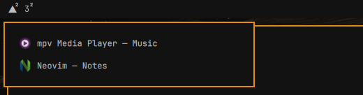

# omext workspaces

Part of [**omarchy-extended**](https://github.com/omarchy-extended): addons for [Omarchy](https://omarchy.org).

Workspaces that keep out of the way. They're all still there, and one click or
key away when you want one, but the bar doesn't show a row of them, and nothing
sends you to another one by accident.



## Why

Omarchy is built around workspaces: ten per screen, a row of numbers on the
bar, and several ways to move between them. If that's how you work, you don't
need this.

If you come from Windows, you probably work the other way round: everything on
one desktop, windows you arrange and minimize, and a second desktop only now
and then, when a task wants a clean one. On Omarchy that habit runs into
trouble:

- **Windows go missing.** A scroll over the bar's numbers, or with Super held,
  switches workspace. You don't notice, open an app, and it's on workspace 4.
  Later you can't find it.
- **Empty workspaces look like places to be.** Five numbers on the bar, four of
  them empty, are four ways to end up somewhere with nothing on it.
- **A click can change more than you meant.** On Omarchy's widget, a click on
  the workspace you're on changes its layout, and a floating desktop is
  suddenly tiled.

omext workspaces turns that around. A workspace is something you go to on
purpose, when you need it, as you'd open a second desktop on Windows:

- **The bar shows workspace 1**, and another one only while something is on it
  (or it's the one in front of you). Go to 3 with Super + 3 and it appears; leave
  it empty and it's gone again.
- **Each number with windows on it says how many**, small beside it. Point at it
  for a list of those windows; click one to go to it.
- **No switching by accident.** A scroll over the numbers does nothing, and
  Super + scroll wheel is taken off. A click on the workspace in front of you
  leaves its layout alone.
- **The keys you'd use on purpose are untouched:** Super + 1 ... 0, Super + Tab,
  Super + Shift + a number to send a window somewhere.

It goes well with [omext taskbar](https://github.com/omarchy-extended/taskbar),
which shows every open window whatever workspace it's on, and can bring them
all onto the one in front of you.

## Settings

In `~/.config/omext/workspaces.json`, the same for every screen's bar:

| Key | Default | What it does |
|-----|---------|--------------|
| `always` | `[1]` | The workspaces the bar always shows, 1 to 10. `[1, 2, 3, 4, 5]` is Omarchy's own row. |
| `scroll` | `false` | `true`: a scroll over the numbers goes to the next workspace or the one before. |
| `superScroll` | `false` | `true`: Super + scroll wheel does too (Omarchy's own keys, left on). |
| `counts` | `true` | `false`: no window counts beside the numbers. |
| `list` | `true` | `false`: no list of a workspace's windows when it's pointed at. |

The first three are also in the Omarchy menu › Setup › Omarchy Extended, and
any of them from a script:

```bash
omext-settings set workspaces always '[1, 2, 3]'
omext-settings toggle workspaces scroll
```

## Install

```bash
git clone https://github.com/omarchy-extended/workspaces.git ~/.local/share/omext-workspaces
~/.local/share/omext-workspaces/install.sh
```

It takes the place of Omarchy's workspaces on the bar. Turn it off or on in the
Omarchy menu › Setup › Omarchy Extended › Workspaces (off: Omarchy's own are
back). A `git pull` in that folder updates it. `./uninstall.sh` removes it.

Needs **Omarchy 4.5** or later. It uses
[omext core](https://github.com/omarchy-extended/core) (what the omext addons
share): `install.sh` installs that too, when it's missing.

Each screen has its own ten workspaces on Omarchy, and each screen's bar shows
its own. The ones of a screen you've unplugged show after them, set apart,
while they're visiting.

## What it's made from

The widget is Omarchy's own workspaces widget, changed: the layout marks, the
per-screen workspaces and the look are Omarchy's.

## License

MIT. See [LICENSE](LICENSE).
